<div align="center">

# ekonometri-tr

Türkçe ekonometri kütüphanesi. Tahmin, Türkçe yorum, varsayım testi ve Word raporu.

[](https://github.com/ytrdev/ekonometri-tr/actions/workflows/testler.yml)


-orange)

[Kurulum](#kurulum) · [Hızlı başlangıç](#hızlı-başlangıç) · [Kendi verin](#kendi-verin) · [Stata kullanıcıları için](#stata-kullanıcıları-için) · [Bulgu raporu](#bulgu-raporu-tez--makale--ödev) · [Grafikler](#grafikler) · [Özellikler](#özellikler) · [Ders defterleri](#ders-defterleri) · [Yol haritası](#yol-haritası) · [Katkı](#katkıda-bulun)

</div>

---

`model.yorumla()` katsayıyı Türkçe söyler, `model.varsayimlar()` testi yazar, `model.rapor("bulgular.docx")` Yöntem ve Bulgular metnini Word dosyasına koyar. Sayılar statsmodels ve linearmodels ile karşılaştırıldı.

```python
import ekonometri as ek

veri = ek.veri.yukle("ucret")
model = ek.ekk("np.log(ucret) ~ egitim + tecrube + I(tecrube**2) + cinsiyet", veri,
               birimler={"egitim": "yıl", "tecrube": "yıl"})

model                 # Türkçe sonuç tablosu
model.yorumla()       # katsayıların Türkçe yorumu
model.varsayimlar()   # varsayım testleri + öneriler
model.rapor("bulgular.docx")   # Yöntem + Bulgular metni ve tablolar, Word dosyası
```

## Nasıl görünüyor?

**`model`** — tanıdık sonuç tablosu, Türkçe:

```
══════════════════════════════════════════════════════════════════════════════
 EKK Regresyon Sonuçları — bağımlı değişken: ln(ucret)
══════════════════════════════════════════════════════════════════════════════
 Gözlem sayısı: 1500         R²: 0,3609       Düzeltilmiş R²: 0,3592
 F(4, 1495): 211,10     p: <0,0001      AIC: 1.749,1    BIC: 1.775,7
 Standart hatalar: klasik (homoskedastik)
──────────────────────────────────────────────────────────────────────────────
 Değişken                         Katsayı   Std. hata        t         p
──────────────────────────────────────────────────────────────────────────────
 Sabit                             9,6026      0,0532   180,38   <0,0001 ***
 cinsiyet: Kadın                  -0,1228      0,0228    -5,39   <0,0001 ***
 egitim                            0,0808      0,0031    25,71   <0,0001 ***
 tecrube                           0,0415      0,0029    14,31   <0,0001 ***
 tecrube²                       -0,000712    0,000060   -11,79   <0,0001 ***
──────────────────────────────────────────────────────────────────────────────
 Anlamlılık: *** %1  ** %5  * %10        Yorum için: model.yorumla()
══════════════════════════════════════════════════════════════════════════════
```

**`model.yorumla()`** — ne anlama geldiğini söyler (log, kare terim ve kuklaları doğru tanır):

```
▸ Katsayılar (diğer değişkenler sabitken)
  • 'cinsiyet' değişkeninde 'Kadın' grubunun 'ucret' değeri, referans grupla ('Erkek')
    karşılaştırıldığında ortalama %11,6 daha düşük — %1 düzeyinde istatistiksel olarak anlamlı (p < 0,0001).
  • 'egitim' 1 yıl artınca 'ucret' ortalama %8,42 artıyor — %1 düzeyinde istatistiksel olarak anlamlı (p < 0,0001).
  • 'tecrube' değişkeninin etkisi doğrusal değil: önce artan sonra azalan (ters U) bir ilişki var.
    Etki, 'tecrube' ≈ 29,12 yıl civarında yön değiştiriyor.
```

**`model.varsayimlar()`** — sorunu bulur ve çözüm önerir:

```
⚠️ Breusch-Pagan (Sabit varyans): istatistik = 39,758, p < 0,0001
   H0: Hata varyansı sabittir (homoskedastisite).
   p < 0,05: H0 reddedildi — değişen varyans var. Katsayılar yansız ama standart hatalar
   (ve t/p değerleri) güvenilmez.
   👉 Öneri: Sağlam standart hata kullan: ek.ekk(..., kovaryans='HC1') — Stata: regress ..., vce(robust).
```

Jupyter'de tüm çıktılar düzenli HTML tablolar olarak görünür.

## Bulgu raporu (tez / makale / ödev)

```python
model = ek.ekk("np.log(ucret) ~ egitim + tecrube + I(tecrube**2) + cinsiyet + sektor", veri,
               kovaryans="HC1", birimler={"egitim": "yıl", "tecrube": "yıl"})

model.rapor("bulgular.docx",
            etiketler={"ucret": "Aylık ücret", "egitim": "Eğitim süresi", "tecrube": "Tecrübe"})
```

Tek satır şunları üretir ([örnek Word dosyası](ornekler/bulgular.docx)):

<p align="center">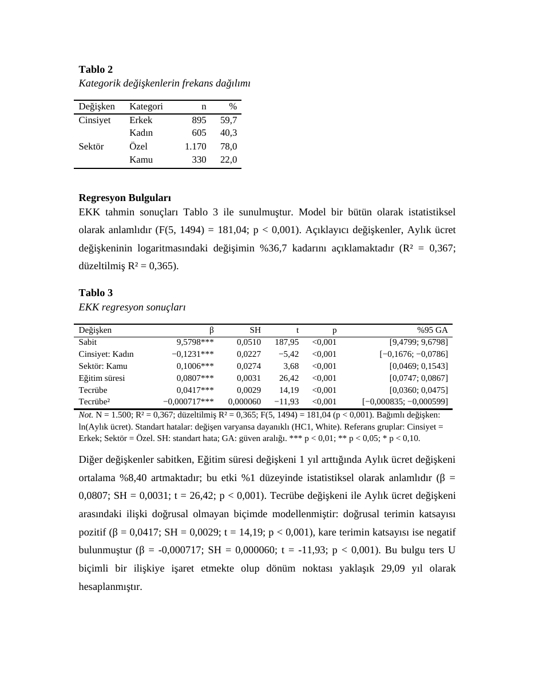</p>

| Bölüm | İçerik |
|---|---|
| **Yöntem** | Model denklemi, tahmin yöntemi, standart hata türü ve kullanılan testler; kaynak gösterimleriyle |
| **Tanımlayıcı istatistikler** | Sürekli değişkenler (N, ortalama, std. sapma, en küçük, en büyük) ve kategorik değişkenlerin frekans tablosu |
| **Regresyon bulguları** | Tez formatında tablo (β, SH, t, p, %95 GA) + her katsayının akademik Türkçe yorumu |
| **Varsayım testleri** | Test tablosu + "sınanmış, şu bulunmuş, bu nedenle şu yapılmıştır" metni |
| **Kaynakça** | Metinde atıf yapılan kaynaklar (APA) |

Metinden bir örnek:

> Diğer değişkenler sabitken, Eğitim süresi değişkeni 1 yıl arttığında Aylık ücret değişkeni ortalama %8,40 artmaktadır; bu etki %1 düzeyinde istatistiksel olarak anlamlıdır (β = 0,0807; SH = 0,0031; t = 26,42; p < 0,001). […] Değişen varyans, Breusch-Pagan (LM = 40,63; p < 0,001) ve White (LM = 48,52; p < 0,001) testleriyle sınanmıştır. Her iki test de sabit varyans varsayımının sağlanmadığını göstermektedir. Bu nedenle çıkarımlar değişen varyansa dayanıklı standart hatalara (HC1) dayandırılmıştır.

Seçenekler: `.docx`, `.md` ya da `.html` çıktı · `etiketler` ile değişken adları · `tablo_no=5` ile tablo numarasını tezine göre başlatma · `yontem=False` ile yalnızca bulgular · dosya vermeden `print(model.rapor())`.

Rapor, modelin hesapladığı sayıları cümleye döker. Metni okuyup kendi çalışmana göre düzeltmen gerekir.

## Grafikler

Türkçe etiketli (ondalık virgül, binlik nokta) grafikler. Hepsi `.kaydet("x.png")` ile 300 dpi kaydedilir ya da `rapor.sekil_ekle()` ile Word raporuna **Şekil N** olarak girer. Stata komutlarıyla da çizilir: `rvfplot`, `coefplot`, `marginsplot`, `graph export`.

| | |
|:---:|:---:|
| 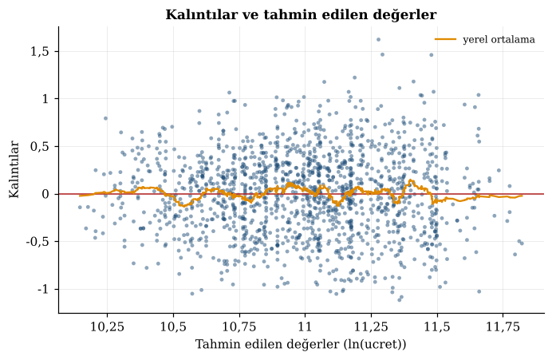 | 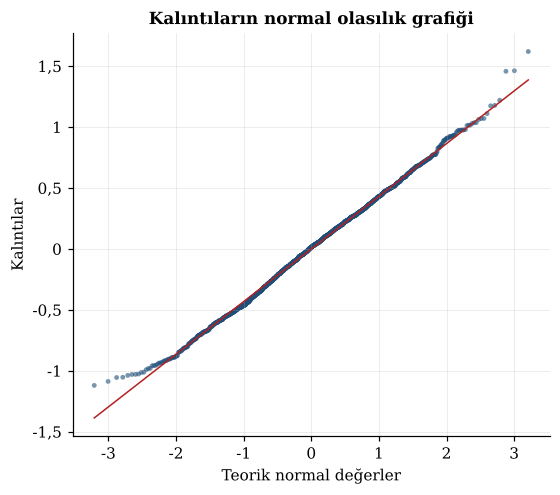 |
| `ek.kalinti_grafigi(m)` · Stata `rvfplot` | `ek.normallik_grafigi(m)` · Stata `qnorm` |
| 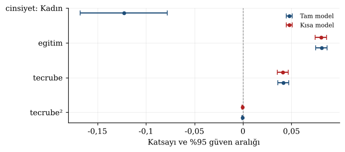 | 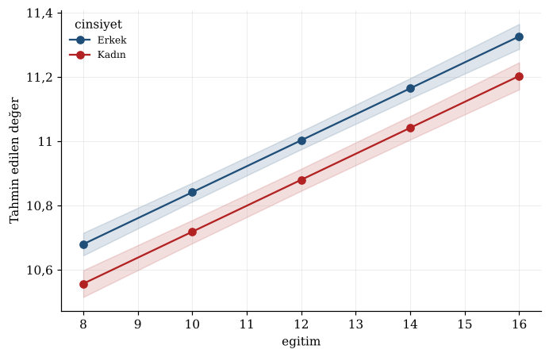 |
| `ek.katsayi_grafigi(m1, m2)` · Stata `coefplot` | `ek.marjinal_grafik(ek.marjlar(m, at=…, grup=…))` · Stata `marginsplot` |
| 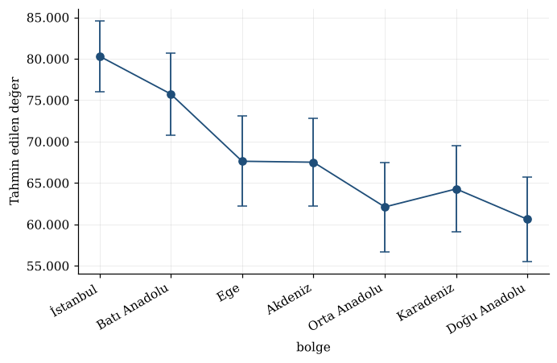 | 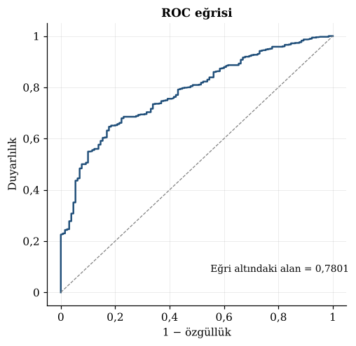 |
| `margins bolge` + `marginsplot` | `ek.roc_grafigi(logit)` · Stata `lroc` |
| 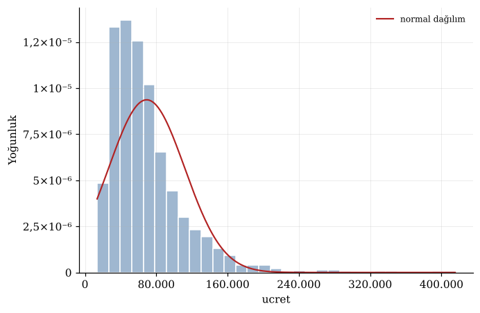 | 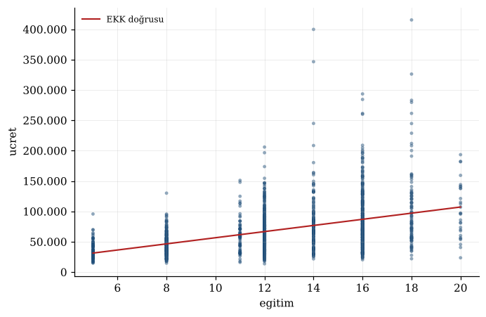 |
| `ek.histogram(veri, "ucret")` · Stata `histogram, normal` | `ek.serpme(veri, "ucret", "egitim")` · Stata `twoway (scatter)(lfit)` |
| 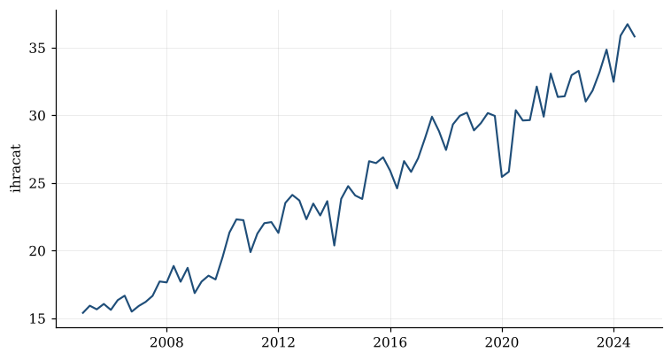 | 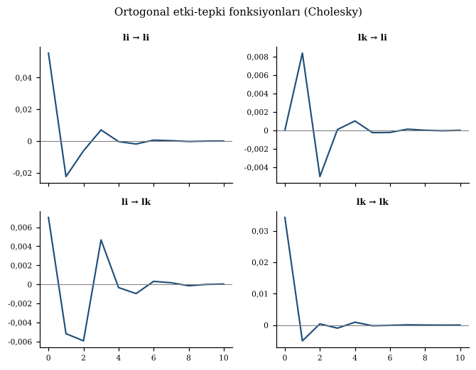 |
| `ek.zaman_grafigi(veri, "ihracat")` · Stata `tsline` | `ek.var(...).etki_tepki_grafigi(10)` · Stata `irf graph oirf` |

## Kurulum

```bash
pip install git+https://github.com/ytrdev/ekonometri-tr
```

> PyPI sürümü (`pip install ekonometri-tr`) v1.0 ile gelecek. Python 3.10 ve üzeri gerekir.

## Hızlı başlangıç

```python
import ekonometri as ek

ek.veri.listele()                    # hazır veri setleri
print(ek.veri.aciklama("konut"))     # değişkenler + veriyi üreten gerçek model

veri = ek.veri.yukle("konut")
model = ek.ekk("np.log(fiyat) ~ np.log(metrekare) + bina_yasi + asansor + il", veri, kovaryans="HC1")

model.yorumla()                                  # esneklik yorumu: 'metrekare' %1 artınca fiyat ≈ %0,9 artıyor
model.wald_testi("np.log(metrekare) = 1")        # doğrusal kısıt testi
model.tahmin(veri.head())                        # yeni gözlemler için tahmin
model.guven_araliklari(0.95)                     # güven aralıkları
```

Diğer yöntemler aynı mantıkla çalışır:

```python
# birden çok modeli yan yana (tez tablosu)
ek.karsilastir(m1, m2, m3).rapor("modeller.docx")

# 0/1 bağımlı değişken
ek.logit("gecti ~ calisma_saati + devam + burs", ek.veri.yukle("sinav")).marjinal_etkiler()

# zaman serisi: durağanlık tablosu ve eşbütünleşme
ek.duraganlik(veri, ["ihracat", "reel_kur"], log=True).rapor("birim_kok.docx")
ek.engle_granger("np.log(ihracat) ~ np.log(reel_kur)", veri)
ek.hata_duzeltme("np.log(ihracat) ~ np.log(reel_kur)", veri).rapor("hata_duzeltme.docx")
ek.granger(np.log(veri["ihracat"]), np.log(veri["reel_kur"]), gecikme=2)
ek.var_granger(veri, ["ihracat", "reel_kur", "dunya_buyumesi"], gecikme=2)
ek.ardl_sinir("np.log(ihracat) ~ np.log(reel_kur) + dunya_buyumesi", veri, gecikme=2)
ek.johansen(veri, ["ihracat", "reel_kur"], gecikme=1)

# İngilizce metin veya tüm kenarlıkları çizili tablo
model.rapor("findings.docx", dil="en", bicim="izgara")

# panel veri: üç model + F / LM / Hausman testleri + önerilen model
ek.panel_analizi("np.log(satis) ~ np.log(calisan) + np.log(sermaye)", ek.veri.yukle("firma"),
                 birim="firma", zaman="yil").rapor("panel.docx")
ek.xtabond("np.log(satis) ~ np.log(calisan)", ek.veri.yukle("firma"), birim="firma", zaman="yil")

# araç değişken (2SLS)
ek.iv2sls("np.log(ucret) ~ tecrube + [egitim ~ uzaklik + kardes]", ek.veri.yukle("getiri")).tanilar()
```

## Kendi verin

```python
veri = ek.oku("anket.dta")            # Stata: değişken ve değer etiketleri korunur
veri = ek.oku("veri.xlsx", sayfa=0)   # Excel
veri = ek.oku("tuik.csv")             # CSV: ';' ayırıcı, ondalık virgül ve Türkçe karakterler otomatik
veri = ek.oku("anket.sav")            # SPSS (pip install pyreadstat)

ek.ekk("np.log(ucret) ~ egitim + C(bolge)", veri).rapor("bulgular.docx")
```

`.dta` dosyalarındaki **değişken etiketleri** raporda değişken adının yerine geçer ("Eğitim süresi (yıl) değişkeni 1 yıl arttığında…"). Stata'daki gibi `ek.xtset(veri, "il", "yil")`, `ek.tsset(veri, "yil")`, `ek.etiketle(veri, {...})` ve `ek.kaydet(veri, "temiz.dta")` da var.

## Stata kullanıcıları için

Stata komutunu burada da yazabilirsin. Do dosyası da çalışır:

```python
s = ek.Stata()
s("use anket.dta")
s("gen lnw = ln(ucret)")
s("regress lnw egitim c.tecrube##c.tecrube i.cinsiyet i.bolge, vce(cluster il)")
s("estat hettest")
s("estimates store m1")
s("xtset il yil")
s("xtreg lnw egitim, fe vce(robust)")
s("rapor bulgular.docx")            # + Türkçe tez raporu

s.do("analiz.do")                   # hazır do dosyası
```

- **Tahmin ve test komutları:** `regress`, `newey`, `prais`, `logit`, `probit`, `ologit`, `oprobit`, `mlogit`, `poisson`, `nbreg`, `tobit`, `xtreg fe/re`, `xtabond`, `ivregress 2sls`, `dfuller`, `zandrews`, `xtunitroot`, `pescadf`, `xtcd`, `xtcsd`, `var`, `varsoc`, `ardl`, `vecrank`, `margins` (`at()`), `lincom`, `estat …`, `hausman`, `xttest0`, `test`, `ttest`, `oneway`, `tabulate, chi2`, `predict`, `esttab using`.
- **Grafikler:** `rvfplot`, `qnorm`, `histogram`, `scatter`, `twoway (scatter)(lfit)`, `tsline`, `coefplot`, `marginsplot`, `lroc`, `irf graph`, `graph export`.
- **Veri düzenleme:** `gen`, `replace`, `egen`, `merge`, `append`, `reshape`, `collapse`, `encode`, `destring`, `label define/values`, `recode`, `duplicates` ve diğerleri.
- **Ağırlıklar:** `[aw=]`, `[fw=]`, `[pw=]`.
- **Değişken dili:** Faktör değişkenleri (`i.`, `ib#.`, `##`), zaman serisi işlemcileri (`L.`, `D.`, `F.`), `if` ve `in`.
- **İfade kuralları Stata ile aynı:** Eksik değer +∞ sayılır, değer etiketli değişkenlerde `if cinsiyet == 2` çalışır.
- **Standart hatalar Stata kurallarıyla hesaplanır:**
  - `vce(robust)` çarpanı n/(n−k).
  - `vce(cluster)` çarpanı G/(G−1)·(n−1)/(n−k), G − 1 serbestlik derecesiyle.
  - `xtreg, re` için z istatistiği.
  - `ivregress` için büyük örneklem varsayılanı.

Belge sitesi: **https://ytrdev.github.io/ekonometri-tr/** · Komut karşılıkları, uyum kuralları ve bilinen farklar: **[REHBER.md](REHBER.md)** · Örnek: [ornekler/ornek_analiz.do](ornekler/ornek_analiz.do)

## Özellikler

Her model için aynı üç adım: **tahmin et → Türkçe yorumla → tez raporu üret** (`model.yorumla()`, `model.rapor("dosya.docx")`).

| Konu | Fonksiyonlar | İçerik |
|---|---|---|
| **Doğrusal regresyon** | `ek.ekk()` | EKK · formül arayüzü (`log()`, `I(x**2)`, `C(kategori)`, etkileşim `x1:x2`, `x*grup`) · standart hatalar: klasik, `HC0`–`HC3`, `HAC` (Newey-West) |
| **Varsayım testleri** | `model.varsayimlar()` | Breusch-Pagan · White · Durbin-Watson · Breusch-Godfrey · Jarque-Bera · VIF · Ramsey RESET — her biri karar + öneri ile |
| **Tablolar** | `ek.karsilastir()` · `ek.korelasyon()` · `ek.tanimlayici()` | Model 1–2–3 yan yana karşılaştırma tablosu · Word / LaTeX (booktabs) / Excel / CSV dışa aktarma (`esttab using`) · Pearson/Spearman korelasyon matrisi (yıldızlı) · tanımlayıcı istatistikler |
| **İkili seçim** | `ek.logit()` · `ek.probit()` | En çok olabilirlik · ortalama marjinal etkiler (delta yöntemi) · odds oranları · sınıflandırma tablosu · ROC/AUC · Hosmer-Lemeshow · McFadden R² |
| **Sıralı, çok terimli, sayım, sansürlü** | `ek.ologit()` · `ek.oprobit()` · `ek.mlogit()` · `ek.poisson()` · `ek.nbreg()` · `ek.tobit()` | Stata ile aynı kesim noktası tanımı ve temel kategori kuralı · göreli risk / olay oranları · sonuç başına marjinal etkiler · aşırı yayılım LR testi · alt/üst sansür |
| **Doğrusal birleşim** | `ek.lincom()` | Stata `lincom`: katsayıların doğrusal birleşimi (ör. `x1 - x2`, `_cons + kukla`), standart hata, t/z testi ve güven aralığı; tüm modellerde |
| **Marjlar** | `ek.marjlar()` | Stata `margins`: `at()` ile koşullu tahmin, grup marjları, koşullu marjinal etki `dydx() at()`, delta yöntemi |
| **Grafikler** | `ek.kalinti_grafigi()` · `ek.katsayi_grafigi()` · `ek.marjinal_grafik()` · `ek.zaman_grafigi()` · `ek.histogram()` · `ek.serpme()` · `ek.roc_grafigi()` | rvfplot, qnorm, coefplot, marginsplot, tsline, histogram, scatter + lfit, lroc · Türkçe, ondalık virgül, 300 dpi · rapora numaralı **Şekil** olarak eklenir |
| **Zaman serisi** | `ek.adf()` · `ek.kpss()` · `ek.duraganlik()` · `ek.engle_granger()` · `ek.hata_duzeltme()` · `ek.granger()` · `ek.var_granger()` · `ek.ardl_sinir()` · `ek.johansen()` · `ek.toda_yamamoto()` · `ek.zivot_andrews()` | Birim kök testleri (MacKinnon p-değerleri) · Zivot-Andrews yapısal kırılmalı birim kök (kırılma tarihi + grafik) · düzey + birinci fark tez tablosu, I(0)/I(1) kararı · Engle-Granger ve Johansen eşbütünleşme · hata düzeltme modeli · Granger nedensellik · VAR (`ek.var`: gecikme seçimi, kararlılık, etki-tepki) · VAR içinde blok dışsallık · Toda-Yamamoto nedensellik (I(1) / eşbütünleşik serilerde) · ARDL sınır testi · VAR tez raporu ve Türkçe yorum |
| **Panel veri** | `ek.panel()` · `ek.panel_analizi()` · `ek.hausman()` · `ek.xtabond()` · `ek.panel_birim_kok()` · `ek.yatay_kesit_bagimliligi()` · `ek.cips()` | Havuzlanmış EKK · sabit etkiler (tek / iki yönlü) · rassal etkiler (Swamy-Arora) · F, Breusch-Pagan LM ve Hausman testleriyle model seçimi · kümelenmiş standart hata · Arellano-Bond fark GMM (AR(1)/AR(2), Sargan) · panel birim kök: LLC, IPS, Fisher-ADF · yatay kesit bağımlılığı: Pesaran CD, Breusch-Pagan LM, ölçekli LM · ikinci nesil birim kök: CIPS (Pesaran, 2007) · hepsi için tez tablosu |
| **Araç değişken** | `ek.iv2sls()` | 2SLS · birinci aşama F ve kısmi R² (zayıf araç) · Wu-Hausman içsellik · Sargan aşırı tanımlama |
| **Türkçe yorum** | `model.yorumla()` | düz/log/esneklik, kukla + referans grup, kare terim + dönüm noktası, etkileşim, olasılık (yüzde puan) |
| **Bulgu raporu** | `.rapor("x.docx")` | Yöntem + Bulgular metni, tez tabloları (`bicim="apa"` veya `"izgara"`), kaynakça · `dil="en"` ile İngilizce metin (EKK, panel, logit/probit, 2SLS, zaman serisi, karşılaştırma) · Word / Markdown / HTML |
| **Kendi verin** | `ek.oku()` · `ek.xtset()` · `ek.tsset()` · `ek.kaydet()` | Stata .dta (etiketlerle), Excel, CSV (Türkçe biçim), SPSS · gecikme / fark (L., D.) |
| **Klasik testler** | `ek.ttest()` · `ek.ki_kare()` · `ek.anova()` · `ek.prais()` · `ek.xttest0()` | t testi, χ² bağımsızlık, tek yönlü ANOVA, Prais-Winsten / Cochrane-Orcutt, rassal etkiler LM |
| **Ağırlıklar** | `agirlik=`, `agirlik_turu=` | Stata `[aw=]`, `[fw=]`, `[pw=]` — EKK, logit, probit, summarize |
| **Stata komutları** | `ek.Stata()` · `.do()` | Stata komutları, faktör ve zaman serisi değişken dili, do dosyaları — [REHBER.md](REHBER.md) |
| **Veri setleri** | `ek.veri.yukle()` | 6 simüle veri seti, her birinin gerçek modeli belli (cevap anahtarı) |

### Doğruluk

Doğrusal modeller, panel, 2SLS ve testler matris cebiriyle sıfırdan yazıldı; sıralı, çok terimli ve sayım modellerinde en çok olabilirlik optimizasyonu için statsmodels kullanılır. **Her sonuç test paketinde yerleşik kütüphanelerle birebir karşılaştırılır**:

| Konu | Karşılaştırılan | Kapsam |
|---|---|---|
| EKK ve varsayım testleri | [statsmodels](https://www.statsmodels.org) | katsayılar, HC0–HC3, HAC, R², F, AIC/BIC, 7 test |
| Logit / probit | statsmodels | katsayılar, klasik ve sandviç standart hatalar, log-olabilirlik, marjinal etkiler |
| ADF, KPSS, Engle-Granger | statsmodels | istatistik, gecikme seçimi (AIC/BIC), MacKinnon p-değeri ve kritik değerler |
| Granger nedensellik, hata düzeltme | statsmodels | SSR F ve χ²; ECM katsayıları ve klasik standart hatalar |
| ARDL sınır testi | statsmodels | UECM F istatistiği. Kritik değerler PSS tanımıyla, açıklayıcı sayısına göre |
| VAR Granger | statsmodels | tek denklem EKK F testi |
| Johansen | statsmodels | iz ve en büyük özdeğer istatistikleri, kritik değerler |
| Panel veri | [linearmodels](https://bashtage.github.io/linearmodels/) | havuzlanmış, sabit (tek/iki yönlü), rassal etkiler; dengeli ve dengesiz panel; kümelenmiş standart hata; R² ölçüleri; F testi |
| 2SLS | linearmodels | katsayılar, klasik ve HC1 standart hatalar, birinci aşama F ve kısmi R², Wu-Hausman, Sargan |
| Sıralı / çok terimli logit, poisson, nbreg, tobit | R `MASS`, `nnet`, `AER` | katsayılar, kesim noktaları, standart hatalar, α, σ, log-olabilirlik |
| Marjlar, ROC | R `marginaleffects`, `pROC` | tahmin marjları, koşullu etkiler, AUC |
| VAR, Arellano-Bond, panel birim kök | statsmodels, R `plm` | VAR katsayıları ve bilgi ölçütleri · xtabond katsayı, sağlam SH, AR(1)/AR(2) · LLC, IPS, Fisher |
| Toda-Yamamoto, Zivot-Andrews, lincom | R `car`, `urca` | Wald χ² · ZA istatistiği ve kırılma tarihi (tüm aday tarihlerde) · doğrusal birleşim ve SH |
| Yatay kesit bağımlılığı, CIPS | R `plm` (`pcdtest`, `cipstest`) | LM, ölçekli LM, CD (dengeli / dengesiz), yanlılığı düzeltilmiş LM · CADF / CIPS (kesik ve kesiksiz) |

Göreli farklar genellikle 10⁻⁸'den küçüktür. Testler her değişiklikte GitHub Actions'ta Python 3.10–3.13 üzerinde otomatik çalışır.

**Bağımsız yazılımlarla doğrulama:** Sonuçlar ayrıca kodumuzdan tamamen bağımsız ücretsiz yazılımlarla, yani R (`estimatr`, `plm`, `AER`, `sandwich`, `lmtest`, `urca`, `MASS`, `nnet`, `pROC`, `car`), gretl ve pyfixest ile karşılaştırıldı. Stata kuralları için bu paketlerin "Stata ile aynı" seçenekleri kullanıldı. 27 karşılaştırma grubunun tamamı tutuyor (çoğunda göreli fark 10⁻¹⁰'dan küçük, iteratif tahminlerde 10⁻⁶'nın altında): [dogrulama/SONUC.md](dogrulama/SONUC.md). Kendin tekrarlamak için: `python dogrulama/karsilastir.py`.

**Stata kuralları:** Standart hata çarpanları, serbestlik dereceleri, z/t seçimi, `summarize, detail` yüzdelikleri ve `xtreg` R² tanımları Stata'nın belgelenmiş varsayılanlarına göre uygulanır. Ayrıntılar ve bilinen küçük farklar (ör. `dfuller` kritik değer tablosu) için [REHBER.md](REHBER.md) dosyasına bak. Stata'nın kendisiyle doğrudan karşılaştırma yapılmadı; farklılık görürsen lütfen bildir.

## Veri setleri

Tüm veri setleri **simüle edilmiştir** — gerçek kişi, konut ya da ülke verisi değildir. Bilinen bir modelden üretildikleri için tahminlerini "cevap anahtarı" ile karşılaştırarak öğrenebilirsin (`ek.veri.aciklama(ad)`).

| Ad | Konu | Öğrettiği |
|---|---|---|
| `ucret` | Mincer ücret denklemi (1.500 kişi) | log–düz model, kare terim, kukla değişken, **değişen varyans** |
| `konut` | Hedonik konut fiyatları (1.000 konut) | log–log, **esneklik**, kategorik değişken, çoklu doğrusal bağlantı |
| `sinav` | Öğrenci başarısı (800 öğrenci) | azalan getiri, düz–düz yorum, **logit/probit** (`gecti`) |
| `ihracat` | Çeyreklik ihracat 2005–2024 | zaman serisi, mevsimsellik, **otokorelasyon**, HAC, birim kök |
| `firma` | Firma üretim fonksiyonu (150 firma × 10 yıl) | **panel veri**: sabit/rassal etkiler, Hausman, zaman etkileri |
| `getiri` | Eğitimin getirisi (2.000 kişi) | **araç değişken**: yetenek yanlılığı, 2SLS, zayıf araç, Sargan |

## Ders defterleri

| Defter | İçerik |
|---|---|
| [01 · Çoklu regresyon](defterler/01_coklu_regresyon.ipynb) | Eğitim ücreti ne kadar artırır? Log yorumu, kare terim, kuklalar, değişen varyans, Wald testi, tahmin |
| [02 · Zaman serisi](defterler/02_zaman_serisi.ipynb) | Durağanlık (ADF, KPSS), sahte regresyon, Engle-Granger, ARDL sınır testi, VAR Granger, Johansen |
| [03 · Logit ve probit](defterler/03_logit_probit.ipynb) | Sınavı geçme olasılığı: marjinal etkiler, odds oranları, sınıflandırma, DOM–logit–probit karşılaştırması |
| [04 · Panel veri](defterler/04_panel_veri.ipynb) | Firma üretim fonksiyonu: havuzlanmış / sabit / rassal etkiler, Hausman, iki yönlü model, Arellano-Bond |
| [05 · Araç değişken](defterler/05_arac_degisken.ipynb) | Eğitimin gerçek getirisi: yetenek yanlılığı, 2SLS, birinci aşama, Wu-Hausman, Sargan |
| [06 · Kendi verin ve Stata komutları](defterler/06_kendi_veri_stata.ipynb) | .dta / Excel / CSV yükleme, etiketler, xtset, Stata komutlarıyla analiz, do dosyası, Word raporu |
| [07 · Tez araç kutusu](defterler/07_tez_arac_kutusu.ipynb) | Grafikler ve Word'e şekil ekleme, `margins, at()`, tabloyu LaTeX / Excel'e aktarma, ologit, nbreg, tobit, panel birim kök, VAR |

## Yol haritası

- [x] **v0.1** — EKK, sağlam standart hatalar, Türkçe yorum, 7 varsayım testi, 4 veri seti, ilk ders defteri
- [x] **v0.2** — Bulgu raporu: `model.rapor("bulgular.docx")` (Yöntem + Bulgular metni, tez formatında tablolar, kaynakça)
- [x] **v0.3** — Model karşılaştırma tablosu, korelasyon matrisi, etkileşim yorumu · logit/probit · ADF, KPSS, Engle-Granger · panel veri (sabit/rassal etkiler, Hausman) · 2SLS · 5 ders defteri
- [x] **v0.4** — Kendi verin (.dta / Excel / CSV / SPSS, etiketler, xtset / tsset) · Stata komutları ve do dosyaları · Stata ile aynı standart hata kuralları
- [x] **v0.5** — Ağırlıklar, veri düzenleme komutları (merge, reshape, collapse…), t testi, χ², ANOVA, Newey-West, Prais-Winsten, xttest0
- [x] **v0.6** — Hata düzeltme modeli (Engle-Granger), Granger nedensellik
- [x] **v0.7** — ARDL sınır testi, VAR içinde Granger, Johansen, Arellano-Bond, tez tablo biçimleri, İngilizce rapor
- [x] **v0.8** — Grafikler (Word'e şekil), `margins at()`, esttab → Word / LaTeX / Excel, ROC ve Hosmer-Lemeshow, ologit / oprobit / mlogit, poisson / nbreg, tobit, VAR (varsoc, varstable, irf), panel birim kök (LLC, IPS, Fisher), belge sitesi
- [ ] **Sonraki sürüm** — Toda-Yamamoto, Zivot-Andrews, Pesaran CD ve CIPS, `lincom`, VAR ve panel birim kök raporları
- [ ] **v1.0** — PyPI'da yayın

## Katkıda bulun

Hata, Türkçe ifade ya da yeni bir test için [CONTRIBUTING.md](CONTRIBUTING.md).

```bash
git clone https://github.com/ytrdev/ekonometri-tr && cd ekonometri-tr
pip install -e ".[gelistirme]"
pytest            # tüm testler
```

## Atıf

Akademik çalışmanda kullandıysan [CITATION.cff](CITATION.cff) dosyasındaki bilgilerle atıf verebilirsin (GitHub sayfasındaki *"Cite this repository"* düğmesi).

## Lisans ve sorumluluk

[MIT](LICENSE). Bu kütüphane eğitim ve araştırma amaçlıdır; doğru model kurulumu, sonuçların yorumlanması ve üretilen rapor metninin kontrolü kullanıcının sorumluluğundadır. Raporu kullandığın çalışmada kütüphaneye atıf vermen ve kurumunun yazım/etik kurallarına uyman beklenir.
